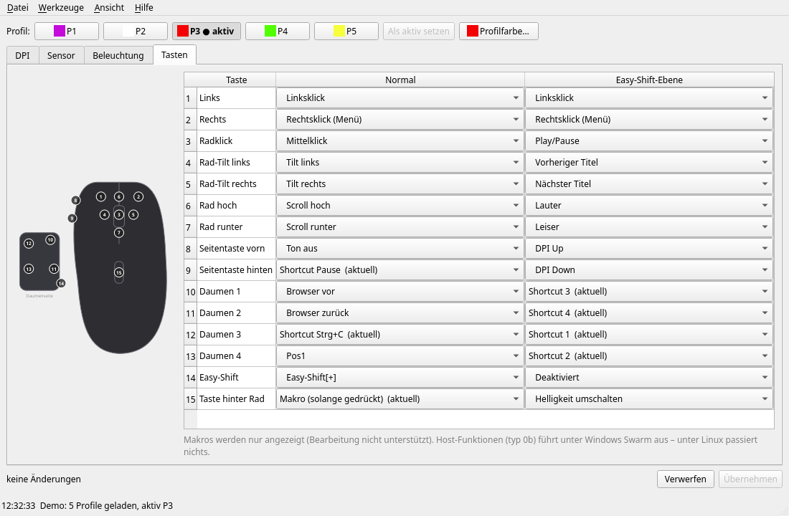

# konexp – ROCCAT Kone XP (und Kone XP Air) unter Linux konfigurieren

[English](README.md) | **Deutsch**

Kommandozeile und Qt-Oberfläche für die **ROCCAT Kone XP** (USB `1e7d:2c8b`), als Ersatz für
ROCCAT Swarm, das es nur für Windows gibt. Die **Kone XP Air** (Kabel `1e7d:2cb2`, Dongle `1e7d:2cb6`)
wird experimentell unterstützt, siehe [unten](#kone-xp-air-experimentell). Die Einstellungen werden direkt in den Speicher der Maus
geschrieben und gelten danach auch ohne laufende Software.



## Funktionen

- **Profile**: 5 Profile, aktives Profil wählen, Profilfarbe
- **DPI**: 5 Stufen (50–19000 in 50er-Schritten), Stufen an/aus, aktive Stufe
- **Sensor**: Polling-Rate (125–1000 Hz), Angle Snapping, Debounce (0–10 ms); Lift-off nur Anzeige
- **Beleuchtung**: Effekt (Fully Lit, Blinking, Breathing, Heartbeat, Photon FX, Colorwave),
  Geschwindigkeit, Helligkeit, Farbe je LED-Gruppe, LED-Timeout
- **Tasten**: 15 Tasten × 2 Ebenen (normal / Easy-Shift): Maus-, DPI-, Profil-, Multimedia- und
  Navigationsfunktionen, Tastatur-Shortcuts mit Modifiern, Easy-Aim
- **Sicherheit**: Änderungen werden gesammelt und vor dem Schreiben als Diff angezeigt; vor jedem
  Write wird gesichert, danach zurückgelesen und bei Abweichung automatisch wiederhergestellt
- Backup/Restore aller Profile, Zurücksetzen auf Werkseinstellungen, Demo-Modus ohne Maus

Noch nicht unterstützt: Makro-Editor (Makros werden angezeigt und bleiben erhalten), Lift-off-Kalibrierung,
AIMO (Software-Beleuchtung), Host-Funktionen wie „Programm öffnen“ (führt unter Windows Swarm aus).

Die Oberfläche ist standardmäßig Englisch. Deutsch per `--lang de` (GUI), `KONEXP_LANG=de` (GUI und CLI)
oder *View → Sprache / Language* (wirkt nach Neustart).
Übersetzungen liegen in `konexp/locale/*.po` (gettext); nach Textänderungen `python3 -m konexp.i18n extract` ausführen.

## Installation

Voraussetzungen: Linux, Python ≥ 3.10.

```sh
git clone https://github.com/cakebomb999/konexp.git
cd konexp
```

Zugriff auf die Maus ohne root (einmalig):

```sh
sudo cp udev/70-kone-xp.rules /etc/udev/rules.d/
sudo udevadm control --reload
sudo udevadm trigger
```

Installation mit [uv](https://docs.astral.sh/uv/) (stellt `konexp` und `konexp-gui` bereit, inkl. PySide6):

```sh
curl -LsSf https://astral.sh/uv/install.sh | sh   # nur falls uv noch fehlt
uv tool install '.[gui]'
```

Aktualisieren nach `git pull` mit `uv tool install --reinstall '.[gui]'`, entfernen mit `uv tool uninstall konexp`.

Alternativ mit System-PySide6 direkt aus dem Repo-Verzeichnis starten (siehe Benutzung):
Arch `sudo pacman -S pyside6`, Debian ≥ 13 / Ubuntu ≥ 25.10 `sudo apt install python3-pyside6.qtwidgets`.

## Benutzung

Nach `uv tool install` ersetzen `konexp-gui` und `konexp` die Aufrufe `python3 -m konexp.gui` / `python3 -m konexp` unten.

Oberfläche (im Repo-Verzeichnis):

```sh
python3 -m konexp.gui          # mit Maus
python3 -m konexp.gui --demo   # ohne Maus, schreibt nichts
```

Kommandozeile:

```sh
python3 -m konexp status                 # alle Profile anzeigen
python3 -m konexp profile 2              # Profil 3 aktivieren (Index 0–4)
python3 -m konexp dpi 2 4 3200           # Profil 3, Stufe 5 auf 3200 DPI
python3 -m konexp dpi-active 2 4         # Profil 3: Stufe 5 aktiv
python3 -m konexp restore <backup.bin>   # gesicherten Report zurückschreiben
python3 -m konexp dump                   # alles als Diagnose-Datei (JSON) speichern, nur Lesen
```

Backups landen in `~/.local/share/konexp/backup/`.

## Kone XP Air (experimentell)

Die Kone XP Air speichert dieselben Datenformate wie die Kone XP, nur mit anderem Transport
([docs/PROTOCOL-XP-AIR.md](docs/PROTOCOL-XP-AIR.md)). An einer echten Maus bestätigt: Lesen per Kabel
und Dongle, Schreiben der Profil-Einstellungen per Kabel. Tasten, Debounce und Profilwechsel laufen genauso,
sind aber noch unbestätigt. Nicht unterstützt: Licht der
Ladestation, Makros, Akkuanzeige.

Wenn etwas nicht stimmt: bitte ausführen (liest nur, ändert nichts) und die Datei an ein GitHub-Issue hängen:

```sh
python3 -m konexp dump                # schreibt konexp-dump-<datum>.json
python3 -m konexp.gui                 # DPI, Licht und Tasten mit der eigenen Einstellung vergleichen
```

Schreiben mit Backup und Rücklesen wie bei der Kone XP. `KONEXP_AIR_WRITE=0` schaltet auf nur Lesen.
Ohne Maus: `python3 -m konexp.gui --demo air`.

## Eigene Maus hinzufügen

Andere ROCCAT- oder Turtle-Beach-Maus? `python3 -m konexp dump` ausführen und mit dem
[Formular](https://github.com/cakebomb999/konexp/issues/new?template=device.yml) ein Issue anlegen, Datei anhängen.
Bei Mäusen, die konexp nicht kennt, sendet der Dump nichts an das Gerät und braucht keine udev-Regel:
Er liest nur USB-IDs und HID-Report-Descriptors aus `/sys`. Das reicht, um das passende Swarm-Plugin
zu finden und mit der Protokollanalyse zu beginnen.

## Sicherheit

`konexp` schreibt nur die Reports, die auch Swarm im Normalbetrieb schreibt. Firmware-Update,
Werksreset per Gerätebefehl (`0x09`) und von Swarm ungenutzte Reports sind gesperrt.
Getestet mit Firmware 1.09. Benutzung auf eigenes Risiko.
Bei der Kone XP Air sind Werksreset (`0x49`), Pairing, Bootloader und Firmware-Update gesperrt.

## Protokoll

Das Konfigurationsprotokoll ist in [docs/PROTOCOL.md](docs/PROTOCOL.md) und
[docs/PROTOCOL-XP-AIR.md](docs/PROTOCOL-XP-AIR.md) beschrieben. Es wurde zur
Herstellung von Interoperabilität (§ 69e UrhG / Art. 6 RL 2009/24/EG) aus ROCCAT Swarm und Messungen an
der Maus ermittelt. Dieses Repository enthält keinen Code und keine Dateien des Herstellers.

## Tests

```sh
python3 -m pytest
```

Die Tests laufen ohne Maus (Demo-Backend mit Werksdaten).

## Lizenz

GPL-3.0-or-later, siehe [LICENSE](LICENSE).

ROCCAT, Kone, Swarm, AIMO und Easy-Shift sind Marken der jeweiligen Inhaber. Dieses Projekt steht in keiner
Verbindung zu ROCCAT oder Turtle Beach.
