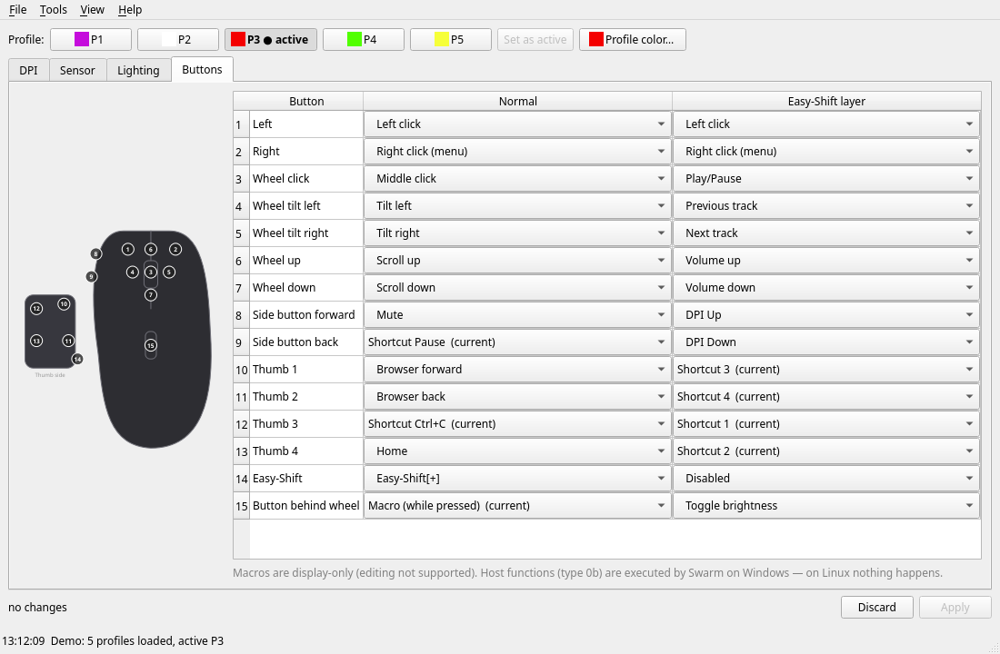

# konexp – configure the ROCCAT Kone XP (and Kone XP Air) on Linux

**English** | [Deutsch](README.de.md)

Command line tool and Qt GUI for the **ROCCAT Kone XP** (USB `1e7d:2c8b`), replacing the Windows-only
ROCCAT Swarm. **Kone XP Air** support (cable `1e7d:2cb2`, dongle `1e7d:2cb6`) is experimental, see
[below](#kone-xp-air-experimental). Settings are written straight into the mouse's onboard memory and stay active without any
software running.



## Features

- **Profiles**: 5 profiles, select the active one, profile color
- **DPI**: 5 stages (50–19000 in steps of 50), enable/disable stages, active stage
- **Sensor**: polling rate (125–1000 Hz), angle snapping, debounce (0–10 ms); lift-off is read-only
- **Lighting**: effect (Fully Lit, Blinking, Breathing, Heartbeat, Photon FX, Colorwave), speed,
  brightness, color per LED group, LED timeout
- **Buttons**: 15 buttons × 2 layers (normal / Easy-Shift): mouse, DPI, profile, media and navigation
  functions, keyboard shortcuts with modifiers, Easy-Aim
- **Safety**: changes are collected and shown as a diff before writing; every write is backed up first,
  read back afterwards and restored automatically if the result differs
- Backup/restore of all profiles, reset to factory defaults, demo mode without a mouse

Not supported yet: macro editor (existing macros are shown and preserved), lift-off calibration,
AIMO (software-driven lighting), host functions such as "open program" (Swarm runs those on Windows).

The user interface is in English by default; German is available via `--lang de` (GUI), `KONEXP_LANG=de`
(GUI and CLI) or *View → Sprache / Language* (takes effect after a restart).
Translations live in `konexp/locale/*.po` (gettext); after changing texts run `python3 -m konexp.i18n extract`.

## Installation

Requirements: Linux, Python ≥ 3.10.

```sh
git clone https://github.com/cakebomb999/konexp.git
cd konexp
```

Allow access to the mouse without root (once):

```sh
sudo cp udev/70-kone-xp.rules /etc/udev/rules.d/
sudo udevadm control --reload
sudo udevadm trigger
```

Install with [uv](https://docs.astral.sh/uv/) (provides `konexp` and `konexp-gui`, PySide6 included):

```sh
curl -LsSf https://astral.sh/uv/install.sh | sh   # only if uv is not installed yet
uv tool install '.[gui]'
```

Update after `git pull` with `uv tool install --reinstall '.[gui]'`, remove with `uv tool uninstall konexp`.

Alternatively use the system PySide6 and run from the repository directory (see Usage):
Arch `sudo pacman -S pyside6`, Debian ≥ 13 / Ubuntu ≥ 25.10 `sudo apt install python3-pyside6.qtwidgets`.

## Usage

After `uv tool install`, `konexp-gui` and `konexp` replace `python3 -m konexp.gui` / `python3 -m konexp` below.

GUI (from the repository directory):

```sh
python3 -m konexp.gui          # with the mouse
python3 -m konexp.gui --demo   # without a mouse, writes nothing
```

Command line:

```sh
python3 -m konexp status                 # show all profiles
python3 -m konexp profile 2              # activate profile 3 (index 0–4)
python3 -m konexp dpi 2 4 3200           # profile 3, stage 5 to 3200 DPI
python3 -m konexp dpi-active 2 4         # profile 3: make stage 5 active
python3 -m konexp restore <backup.bin>   # write a saved report back
python3 -m konexp dump                   # save everything as a diagnostic JSON file (read-only)
```

Backups are stored in `~/.local/share/konexp/backup/`.

## Kone XP Air (experimental)

The Kone XP Air stores the same data formats as the Kone XP, wrapped in a different transport
([docs/PROTOCOL-XP-AIR.md](docs/PROTOCOL-XP-AIR.md)). Reading is confirmed on a real mouse over cable
and dongle, writing the profile settings over the cable. Buttons, debounce and profile switching are written
the same way but not yet confirmed. Not supported: charging dock lighting, macros, battery display.

If something looks wrong, please run this (reads only, changes nothing) and attach the file to a GitHub issue:

```sh
python3 -m konexp dump                # writes konexp-dump-<date>.json
python3 -m konexp.gui                 # check DPI, lighting and buttons against your setup
```

Writes are backed up and read back as for the Kone XP. `KONEXP_AIR_WRITE=0` makes konexp read-only.
Without a mouse: `python3 -m konexp.gui --demo air`.

## Safety

`konexp` only writes the reports that Swarm writes during normal use. Firmware updates, the device
factory-reset command (`0x09`) and reports Swarm never uses are blocked.
Tested with firmware 1.09. Use at your own risk.
For the Kone XP Air, factory reset (`0x49`), pairing, bootloader and firmware-update commands are blocked.

## Protocol

The configuration protocol is documented in [docs/PROTOCOL.md](docs/PROTOCOL.md) and
[docs/PROTOCOL-XP-AIR.md](docs/PROTOCOL-XP-AIR.md) (German). It was
determined for the purpose of interoperability (Art. 6 Directive 2009/24/EC, § 69e UrhG) by analysing
ROCCAT Swarm and measuring a real mouse. This repository contains no code or files from the manufacturer.

## Tests

```sh
python3 -m pytest
```

The tests run without a mouse (demo backend with factory data).

## License

GPL-3.0-or-later, see [LICENSE](LICENSE).

ROCCAT, Kone, Swarm, AIMO and Easy-Shift are trademarks of their respective owners. This project is not
affiliated with ROCCAT or Turtle Beach.
